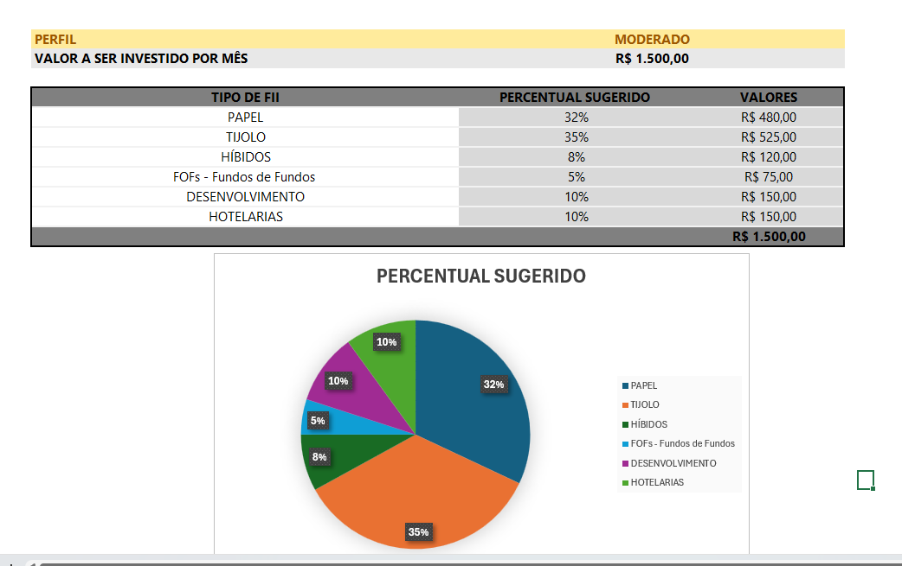
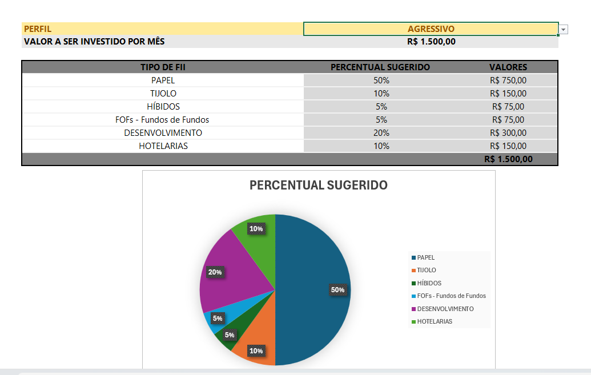

# Ferramenta de Controle de Investimentos com Excel

Esse projeto foi elaborado com fins didáticos com o objetivo de desenvolver uma ferramenta prática e inteligente para organizar o planejamento financeiro e simular a construção de patrimônio no longo prazo. A planilha não só projeta o acúmulo de capital, mas também desenha uma sugestão automática de alocação em Fundos Imobiliários (FIIs) personalizada para o perfil de risco de quem está investindo.

---

## 📈 As Perguntas que a Ferramenta Responde (E onde encontrar cada uma)

Organizei a interface da planilha de forma bem visual para responder de imediato às 5 principais dúvidas de qualquer planejamento financeiro. No bloco principal, chamado **"CONFIGURAÇÕES"**, você configura com o valor de seu salario, rendimento da carteira e o percentual de sugestão mensal de investimentos (onde configurei sugestivamente com 30%), e com base nesses cálculos o nosso sistema calculará o valor de sugestão para investimento.  

Já no bloco **"INVESTIMENTO MENSAL"** você encontra as respostas para:

1. **Quanto Investir por mês?** -> É a célula de entrada onde o usuário define o valor do seu Aportes Mensais com base na porcentagem de sugestão de investimento mensal (aba configurações).
2. **Por Quantos Anos Investir?** -> O horizonte de tempo escolhido para os aportes (definido como 5 anos para a simulação principal), mas podendo ser configurado conforme a vontade do usuário. 
3. **Taxa de Rendimento Mensal?** -> A taxa estimada para o crescimento do dinheiro (ajustada em 1,079% ao mês), contudo deverá o usuário verificar a taxa estimada junto a corretora para melhor visualização. 
4. **Qual Patrimônio Acumulado?** -> A linha de saída automatizada que calcula o montante final bruto após o tempo estipulado, ela retorna o valor investido vezes o tempo investido.
5. **Valor de Dividendo Mensais?** -> O cálculo de quanto esse patrimônio vai gerar de renda passiva pingando na conta todo mês. Esse é o calculo do valor acumulado vezes a taxa de rendimento mensal.

Para facilitar ainda mais a tomada de decisão, criei uma tabela complementar de **Cenários**. Ela responde, de forma integrada, quanto o investidor teria acumulado e qual seria a sua renda mensal exata se resolvesse estender o projeto por **2, 5, 10, 20 ou até 30 anos**.

---

## 🧮 A Lógica por Trás dos Cálculos (VF e PROCV)

Para que a planilha funcionasse sozinha e sem poluição visual, foi utilizado as fórmulas nativas do Excel de maneira estratégica:

### O uso do VF (Valor Futuro)
Em vez de montar tabelas gigantescas simulando mês a mês, usei a função `=VF()`. Ela é o motor que calcula o crescimento do patrimônio a longo prazo. A fórmula cruza os juros compostos com os aportes recorrentes e o tempo total convertido em meses. Foi graças ao `VF` que chegamos ao resultado de patrimônio acumulados nas simulações.

### O uso do PROCV com Chave Composta
Para deixar a distribuição de carteira totalmente automatizada. Criamos uma coluna de **Chave Composta** que junta o perfil escolhido e o tipo de FII (por exemplo: `MODERADO-PAPEL`). 
Quando o usuário altera o perfil na lista suspensa da planilha, a função `=PROCV()` busca essa chave na tabela de referência e extrai o percentual de alocação correto, recalculando o valor em dinheiro que deve ser comprado de cada ativo.

---

## 🏷️ Organização com Intervalos Nomeados

Para que as fórmulas ficassem limpas e fáceis de ler (evitando termos confusos como `A1:B20`), decidimos usar o Gerenciador de Nomes do Excel. Onde nomeamos as principais variáveis do projeto — como as tabelas de referência de alocação e as células de entrada de dados do perfil —, tornando a manutenção da planilha muito mais profissional e intuitiva.

---

## 📊 Distribuição dos Perfis e Origem da Estrutura

Dividimos os percentuais de alocação entre seis classes de Fundos Imobiliários (Papel, Tijolo, Híbridos, FOFs, Desenvolvimento e Hotelarias), calibrando o peso de cada uma de acordo com o apetite ao risco:

*   **CONSERVADOR:** Focado em máxima previsibilidade e menor oscilação. Destinei 50% para Tijolo e 30% para Papel, deixando zerada a exposição a setores mais arriscados, como Desenvolvimento.
*   **MODERADO:** O equilíbrio perfeito. Mantive a base forte em Tijolo (35%) e Papel (32%), mas abri espaço para diversificar com Híbridos (8%), Desenvolvimento (10%) e Hotelarias (10%) buscando um ganho extra de capital.
*   **AGRESSIVO:** Foco total em rendimento acelerado. Concentrei metade de toda a carteira em Papel (50%) e 20% em Desenvolvimento, reduzindo os fundos de Tijolo para apenas 10%.

* **Origem:** Os percentuais aqui utilizados é opcional e podem ser modificados conforme o usuário entender necessário. Os percentuais de cada perfil utilizado são só um exemplo, não contando como recomendação de investimento

---

## 🖼️ Evidências Práticas do Funcionamento

Para garantir e provar que a lógica da planilha está funcionando perfeitamente sem nenhum erro de fórmula, printei duas simulações reais rodando nela:

### 1. Simulação com o Perfil Moderado Ativo
Aqui dá para ver a distribuição equilibrada dos aportes com base nos R\$ 1.500,00 mensais:

### 2. Simulação mudando para o Perfil Agressivo
Note que ao alterar a lista suspensa, todos os percentuais e valores de compra se adaptam instantaneamente:

